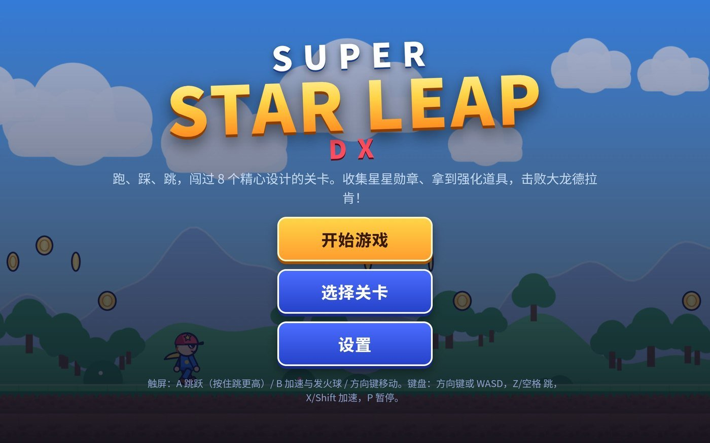
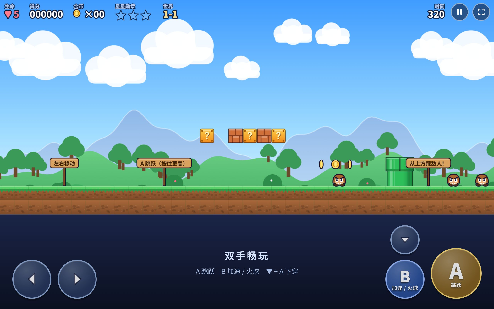
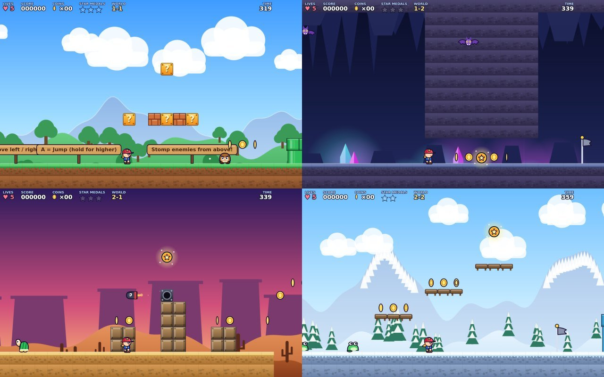
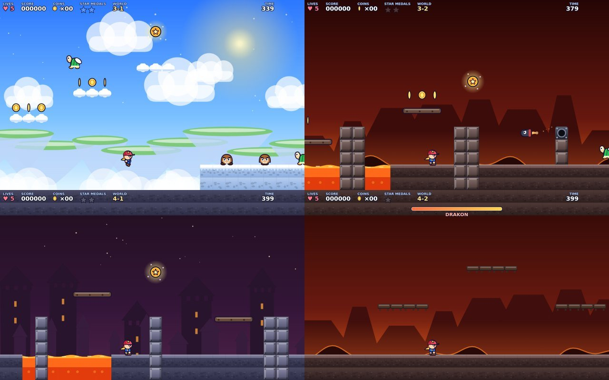
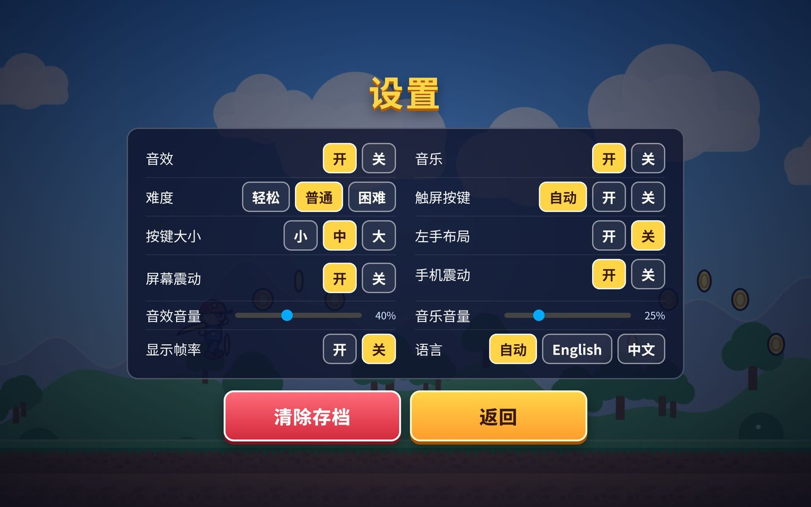
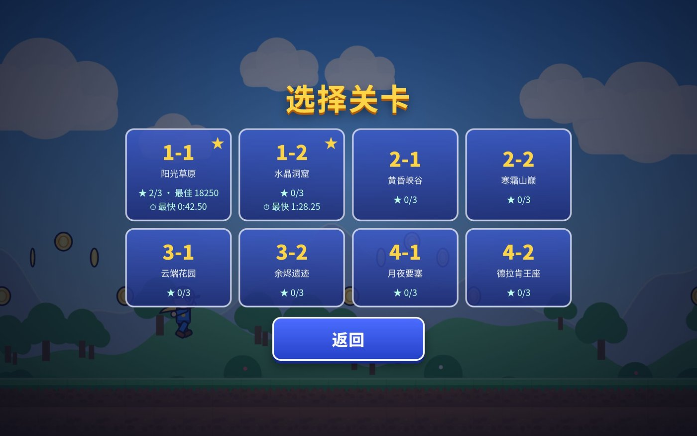
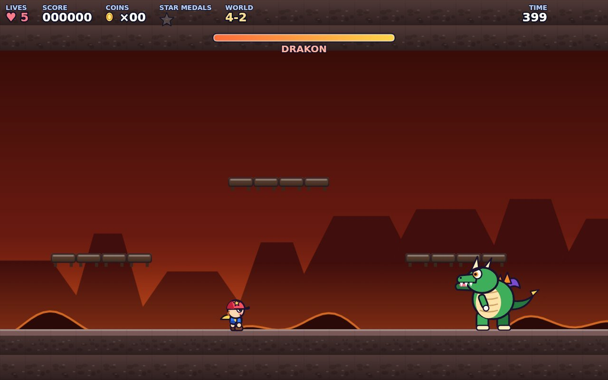
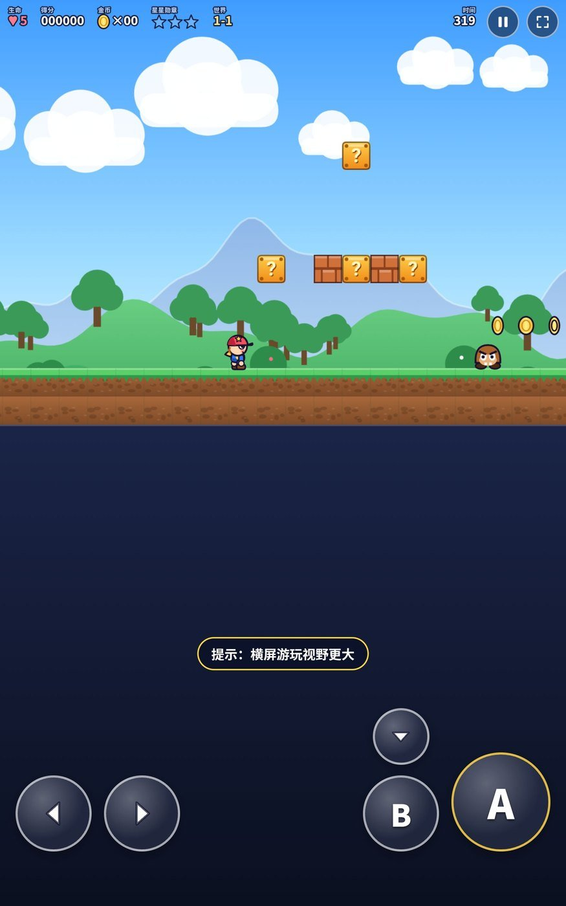

# 超级星跃 DX · Super Star Leap DX

一个为**平板**优化的横版跳跃游戏：纯原生 HTML5 Canvas + Web Audio，**零外部资源、零运行时依赖**，所有美术与音效都由代码实时绘制、合成。



> 原创作品，非任天堂官方产品，不含任何任天堂素材；玩法上致敬经典横版跳跃游戏。

---

## 跳跃与可玩性修复 1.1.1（2026-11-07）

用户反馈“跳不过去”后补测，确认原来的验收标准不足：**旧路线规划器会移除敌人；Boss 是带辅助状态的隔离机制测试，都不是真人或完整无作弊 AI 从头通关。** 以下只按实际完成的范围描述，不再将几何可达性等同于可玩性。

- 短按 A 不再立刻截断上升：静止轻点由约 50px 提升到约 91px，长按上限不变；稍微放宽跳跃缓冲与离崖容错。
- 首关四个主路坑改为两格，三格/四格水管降为两格，补明显踏板，掉下后可以从地面重新起跳，不要求精确接跳。
- 第二关缩短几处无平台辅助的坑与首组尖刺，新增长距离 B+A 教学。
- 新增 `playability.cjs` 和 `full-playtest.cjs`：通过实际 `pointerdown/up` 多指输入回放；保留敌人、伤害、道具和旗杆流程，不修改角色位置/血量/强化/无敌，不移除敌人。
- 完整无作弊 AI 触控回放已通过 **1-1、1-2、2-2、3-1**；这不是全八关连续通关，也不是实体平板真人手感验收。测试固定随机种子只用于复现。

可复现：`npm run playtest`。详细复现、范围及未完成项见 [可玩性补测记录](docs/PLAYABILITY-QA.md)。

## 平板适配版 1.1.0（2026-11-07）

本次优先改善**平板横竖屏、分屏和双手触控**，保留原来的 8 关玩法与旧存档。

- **横屏独立操作面板**：触屏设备默认在画面下方分出按键区，不盖住地面和敌人；设置可切回「悬浮按键」。不足 500px 高的紧凑横屏优先保留游戏画面，自动使用悬浮模式。
- **按键适配**：大小、靠上/居中/靠下、透明度、左手布局均可调整；窄屏自动限制整体尺寸，▼ 至少 44px；左右触控区命中范围不相交。
- **多指操作**：移动、B 加速、A 跳跃可同时按；支持滑动换向、触点取消与释放捕获，不会残留走路/跳跃输入。
- **安全暂停**：旋转、明显改变分屏大小、失焦、切后台时自动暂停并清空按键；返回后主动点「继续」。全屏不再强制锁横屏。
- **菜单与 HUD**：安全区边距、窄窗口滚动、明确焦点、A/B 小字提示、中英操作说明页；长设置页可滑动，不挤出返回按钮。
- **恢复与省电**：修复暂停后重玩无音乐、手柄 Start 无法继续；只在实际游玩时请求屏幕常亮。

推荐：**横屏 → 独立面板 → 中号按键**，再按握持习惯调整。原有存档键 `ssldx:` 保持不变，不会主动清除进度。



详细验证范围与限制见 [平板验收记录](docs/TABLET-QA.md)。

## 玩法特性

| | |
|---|---|
| **8 个关卡** | 阳光草原 / 水晶洞窟 / 黄昏峡谷 / 寒霜山巅 / 云端花园 / 余烬遗迹 / 月夜要塞 / 德拉肯王座（Boss 关） |
| **7 套主题** | 每套独立配色、三层视差背景、粒子环境（落叶、飘雪、余烬、沙尘） |
| **强化道具** | 蘑菇变大、火焰花（按 B 发火球）、无敌星光、1UP 蘑菇 |
| **敌人 8 种 + Boss** | 板栗仔、乌龟（踩出龟壳可踢飞连杀）、刺猬（不能踩）、食人花、跳跳虫、蝙蝠、幽魂、炮台火箭；Boss「德拉肯」会跳砸、喷火、召唤陨石 |
| **收集要素** | 金币（满 100 加一条命）、每关 3 枚星星勋章（共 24 枚）、每关最佳分数与最快纪录 |
| **手感细节** | 土狼时间、跳跃预输入、可变跳跃高度、加速跑、急停转向、踩敌连击计分、下砸（空中按 ↓）、单向下穿平台（↓+A） |
| **其他** | 检查点、移动平台、弹簧、冰面打滑、岩浆、尖刺、旗杆结算、**通关用时与最快纪录**、时间奖励、难度选择（轻松/普通/困难）、音量调节、自动存档、中英双语 |




## 操作

**触屏（平板）**

- 左下 ◀ ▶：移动（按住边缘不回弹，滑动可换方向）
- 右下 **A**：跳跃（按住跳更高）；**B**：加速跑 / 发火球；**▼**：下蹲、空中下砸；**▼+A**：穿过单向平台

**键盘**：方向键 / WASD 移动，`Z` `Space` `K` 跳跃，`X` `Shift` `J` 加速，`↓` 下蹲，`P` `Esc` 暂停
**手柄**：方向键 / 左摇杆移动，A/B 跳跃与加速，Start 暂停与继续

**菜单**：右上角 ⏸ 暂停、⛶ 全屏；设置里可以调音效/音乐开关与音量、难度、按键大小、左手布局、屏幕震动、语言。
**后台自动静音**：切到后台或打开暂停菜单时，音乐与音效会完全停止，不会在后台继续播放。

## 截图

| 选关 | 设置 |
| --- | --- |
|  |  |



竖屏（平板竖着拿）也能玩：游戏画面在上，按键区在下。



---

## 怎么运行

### 方式一：直接双击 `index.html`
整个游戏是纯静态文件，**可以直接用 `file://` 打开**，不需要服务器、不需要联网。

> 唯一限制：离线缓存（Service Worker）只在 http/https 下注册，`file://` 打开时不会生效，但游戏本身完全正常。

### 方式二：本地服务器（推荐，用于测试 PWA）

```bash
# 任选一种
python3 -m http.server 8080
npx serve .
```

然后打开 <http://localhost:8080>。

> 本地开发时 Service Worker 默认**不注册**（避免改代码后看到旧缓存）；想测试离线能力请用 <http://localhost:8080/?sw=1>。

### 方式三：手机 / 平板
用局域网访问电脑上的 `http://<电脑IP>:8080`，或在「添加到主屏幕」后全屏运行（需要 https 或 localhost 才会注册离线缓存）。

## 发布到 GitHub Pages

1. 把本目录推到一个 GitHub 仓库（默认分支 `main`）。
2. 仓库 **Settings → Pages → Build and deployment → Source** 选 **GitHub Actions**。
3. 推送到 `main` 后，`.github/workflows/pages.yml` 会自动发布；地址是 `https://<用户名>.github.io/<仓库名>/`。
4. 在平板浏览器打开该地址，点「添加到主屏幕」，之后可全屏、离线游玩。

仓库里已包含 `.nojekyll`，`manifest.webmanifest`、`sw.js` 与 `icons/`，都是**相对路径**，因此放在任意子路径下都能正常工作。

## 项目结构

```
index.html              入口（Canvas + 菜单 + 触屏按键的 DOM）
css/style.css           界面样式（响应式，横竖屏两套布局）
js/util.js              常量、工具、存档、中英文案
js/tablet.js            平板横竖屏/分屏、独立面板与触控尺寸的纯几何布局
js/audio.js             Web Audio 合成音效与芯片音乐（无音频文件）
js/input.js             键盘 / 多点触控 / 手柄统一输入层
js/gfx_bg.js            主题配色、程序化视差背景、方块贴图缓存
js/gfx_sprites.js       主角与敌人矢量绘制
js/gfx_items.js         道具、火球、Boss、旗杆、城堡
js/levels.js            关卡构建器 + 8 关数据（含教学路牌）
js/entities.js          主角物理与状态
js/world.js             瓦片碰撞、移动平台、砖块、粒子
js/actors.js            敌人 AI 与道具行为
js/boss.js              Boss「德拉肯」状态机
js/sim.js / sim2.js     每帧模拟：碰撞交互、火球、炮台、旗杆结算
js/game.js              状态机、关卡流程、存档、镜头
js/render.js            渲染与 HUD
js/main.js              启动、菜单、设置、暂停、全屏、屏幕常亮
sw.js / manifest.webmanifest / icons/   PWA
tools/                  无头测试与关卡校验工具（不参与运行）
docs/                   README 截图
```

## 架构要点

- **固定 60Hz 步进**：`requestAnimationFrame` 只负责渲染，逻辑按 1/60 秒累积步进，掉帧不会改变手感；单帧最多追 5 步，避免卡顿后「瞬移」。
- **单位**：1 格 = 32 世界单位，画面固定 15 格高，宽度随屏幕比例自适应；渲染时按整数像素对齐，避免接缝。
- **贴图全部程序化**：方块、角色、背景都画在离屏 Canvas 上缓存，按 devicePixelRatio 自动选倍率。
- **物理**：分轴 AABB 瓦片碰撞，支持单向平台、移动平台承载、头部撞砖只顶中间那块、土狼时间与跳跃缓冲。
- **存档**：`localStorage`（键前缀 `ssldx:`），保存解锁进度、每关最佳分、已收集勋章与设置；删档在设置页。

## 开发者工具

`tools/` 里的脚本用 [@napi-rs/canvas](https://www.npmjs.com/package/@napi-rs/canvas)（Skia）在 Node 里跑**游戏真实的 16 个脚本**，不需要浏览器：

```bash
cd tools && npm install

node lint-levels.cjs     # 关卡静态检查：起点/旗杆/管道/敌人/金币/移动平台摆放
node plan.cjs            # 用真实物理搜索，验证 8 关地形都可通关（小个子、无道具）
node medals.cjs medal    # 验证 24 枚勋章都拿得到
node flow.cjs            # 回放规划路线，走完「旗杆→结算→下一关」
node boss.cjs            # Boss 战：踩头与火球两条路都能赢，宝珠与结局正常
node mech.cjs            # 60 项机制测试：踩敌/龟壳/砖块/火球/弹簧/移动平台/存档点/暂停
node audit-fixes.cjs     # 回归：死亡后本关得分累计、低顶棚下成长重试、下蹲爬行不卡死、坏存档不崩
node polish.cjs          # 回归：后台/暂停时音乐完全停止、音量滑块生效
node records.cjs         # 回归：通关用时记录、最快纪录只在新纪录时更新
node tablet-layout.cjs   # 3024 组平板/分屏/安全区/左右手/尺寸组合 + 98 组 DPR
node tablet-input.cjs    # 89 项多指/取消/键盘/旋转/后台/音频/手柄回归
```

这些测试在开发中实际抓出过：旗杆底座卡人、3 格以上高墙跳不过、勋章放进跳不到的高度、移动平台穿墙、Boss 清空弹幕后数组越界等问题。

服务器运行时访问 `tools/browser-tablet.html` 可跑真实浏览器 HTML/CSS 布局矩阵（8 组视口，每组 12 种按键组合及菜单边界）；不需要安装测试依赖。浏览器后台会节流动画，本验收不把手动步进或尺寸模拟表述为持续帧率实测。

## 已知限制

- 音乐是 WebAudio 实时合成，**第一次触摸/点击后才会出声**（移动浏览器的自动播放策略），此时若还没进关就听不到音乐属正常。
- iOS Safari 不支持网页全屏 API，只能「添加到主屏幕」获得全屏体验。
- 全部为程序化绘制，没有像素图素材；想要换成手绘图或像素图，替换 `js/gfx_*.js` 里的绘制函数即可，逻辑层不用动。
- 没有联网、排行榜、多人模式；存档只在本地。

## 许可

代码以 MIT 协议发布，详见 [LICENSE](LICENSE)。美术与音频均由代码生成，同属本作品。

---

## English summary

**Super Star Leap DX** is a tablet-first platformer built with plain HTML5 canvas and Web Audio — no images, no audio files, no runtime dependencies. It ships 8 handcrafted levels across 7 themes, 8 enemy types plus a boss fight, power-ups, star medals, checkpoints, three difficulty levels, local saves, Chinese/English UI, touch + keyboard + gamepad input, and an installable PWA with offline caching.

Run it by opening `index.html` directly, or serve the folder with any static server (`python3 -m http.server 8080`). To publish, push to GitHub and set Pages → Source to **GitHub Actions**; the included workflow deploys it as-is.

`tools/` contains headless tests (Skia canvas + a DOM shim) that run the game's real scripts: level lint, a physics-based completability search, medal reachability, full level-flow replay, the boss fight, and 60 gameplay mechanic checks.

MIT licensed. Not affiliated with Nintendo; all art and audio are generated by code.
